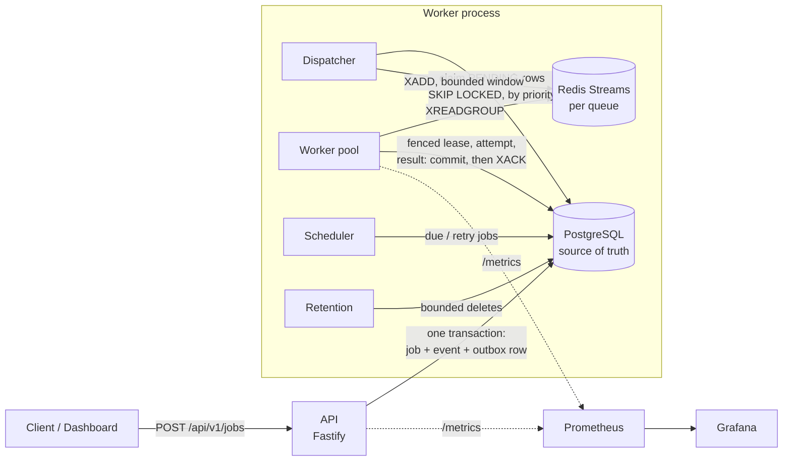
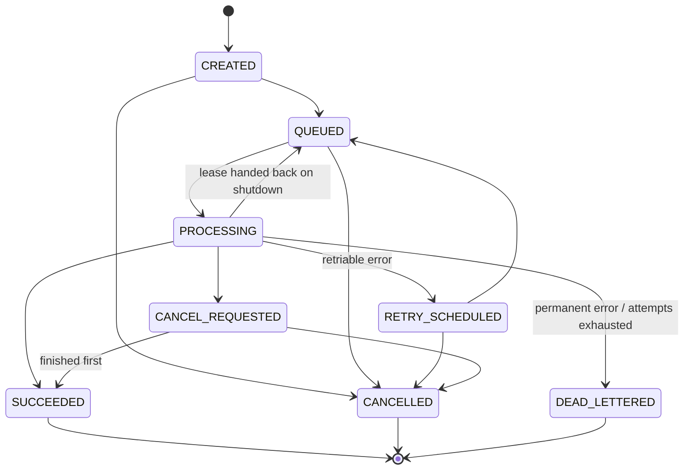

# Resilient TaskFlow

A distributed job queue built on PostgreSQL and Redis Streams. PostgreSQL is the source of truth for job state; Redis only carries delivery notifications. A job that was accepted is never lost, and a job is never committed twice: delivery is **at-least-once**, so handlers must make their external effects idempotent. TaskFlow does not claim exactly-once effects.

It ships a Fastify API, a worker process, a React dashboard, Prometheus and Grafana, and a set of Docker-based failure tests. It has run only on one laptop; it has not been deployed.

## Architecture



Every job write that must reach a worker goes through the **transactional outbox** (`job_deliveries`): the job and its delivery intent commit together, so a crash between "saved" and "queued" cannot lose the job. The dispatcher publishes only a bounded window of entries per queue and always releases the highest-priority rows first ([ADR-012](docs/decisions/012-priority-window.md)).

### Job lifecycle



`FAILED` exists only as a legacy state. The transition table is enforced in code before every status update and pinned by a test.

## Guarantees and how they are met

| Guarantee                    | Mechanism                                                                                                                   |
| ---------------------------- | --------------------------------------------------------------------------------------------------------------------------- |
| An accepted job is not lost  | Transactional outbox; dispatcher republishes anything not yet published                                                     |
| No double commit of a result | Fenced lease (lease id + version) checked in the committing transaction                                                     |
| Crash safety                 | Result committed to PostgreSQL **before** `XACK`; unacked entries are reclaimed                                             |
| Duplicate submissions        | `Idempotency-Key` per user and request body, advisory-locked                                                                |
| Deploys do not burn retries  | Shutdown drains, then hands leases back and refunds the attempt ([ADR-011](docs/decisions/011-shutdown-releases-leases.md)) |
| Priority                     | Postgres-ordered, bounded in-flight window                                                                                  |
| Dispatchers do not overlap   | `FOR UPDATE SKIP LOCKED` with a claim lease                                                                                 |
| Storage stays bounded        | Retention in every worker, one active run at a time via a Redis lock                                                        |

What is **not** guaranteed: exactly-once external effects; a job on a crashed worker is re-run after its lease expires; strict ordering across queues; no starvation of low-priority jobs under sustained high-priority load.

## Measured results

Single MacBook (M3, 8 GB), Postgres and Redis in Docker, load generator on the same machine. These are not production capacity. Details, commands and caveats: [`docs/benchmarking/RESULTS.md`](docs/benchmarking/RESULTS.md).

| Measurement                                               | Result                                                                                |
| --------------------------------------------------------- | ------------------------------------------------------------------------------------- |
| API job submission, one process                           | 500 req/s with p99 346 ms and 0 errors; p99 passes 1 s at 750 req/s                   |
| Drain of a 20,000-job backlog (`noop`), 1 / 2 / 4 workers | 221 / 241 / 203 jobs/s mean of 3 runs; Postgres-bound, does not scale on this machine |
| Worker `SIGKILL` mid-run (10,000 jobs)                    | 0 lost; 8 re-run after the 30 s lease                                                 |
| Worker `SIGTERM` mid-run (10,000 jobs)                    | 0 lost, 0 extra attempts, 0 dead-lettered                                             |

## Quick start

Requires Node 20+, pnpm 8 and Docker.

```bash
pnpm install
cp .env.example .env                       # set JWT_SECRET (32+ chars) and API_KEY_HASH_SALT (16+ chars)
docker compose up -d postgres redis        # add prometheus grafana for monitoring
pnpm db:migrate && pnpm db:seed            # schema and default queues
pnpm db:create-api-key --role admin        # prints the key (stdout is only the key)
pnpm dev:api                               # terminal 1, :3000
pnpm dev:worker                            # terminal 2
pnpm dev:dashboard                         # terminal 3, :3001 (optional)
```

```bash
KEY=<the key printed above>
curl -s -X POST localhost:3000/api/v1/jobs -H "X-API-Key: $KEY" -H 'Content-Type: application/json' \
  -d '{"type":"process-data","payload":{"operation":"transform","data":[{"id":1}]},"queue":"default"}'
curl -s localhost:3000/api/v1/jobs/<id> -H "X-API-Key: $KEY"        # status: SUCCEEDED
```

There is no built-in plaintext development credential; every key comes from the database. Built-in handlers: `send-email` and `process-data`.

### Full stack in Docker

`docker-compose.prod.yml` runs Postgres, Redis, migrations, API, workers, the dashboard behind nginx, Prometheus and Grafana. It is a local, production-style run, not a deployment. See [`docs/docker-production.md`](docs/docker-production.md).

```bash
cp .env.production.example .env.prod.local    # git-ignored; replace every CHANGE_THIS
docker compose -p taskflow-prod --env-file .env.prod.local -f docker-compose.prod.yml up -d --build --wait
# dashboard http://localhost:8080  prometheus :9092  grafana :3003
```

## Verification

Docker must be running for the process and migration suites.

| Command                                     | What it proves                                                                                                              |
| ------------------------------------------- | --------------------------------------------------------------------------------------------------------------------------- |
| `pnpm typecheck && pnpm lint && pnpm build` | Compiles, lints, builds all workspaces                                                                                      |
| `pnpm test`                                 | Package unit suites                                                                                                         |
| `pnpm test:migrations`                      | Real migration runner against Postgres, including data backfills                                                            |
| `pnpm test:api-runtime`                     | API process lifecycle, auth and controls against Postgres and Redis                                                         |
| `pnpm test:worker-integration`              | Real worker processes: lifecycle, commit-before-ACK recovery, kill/replace, retries, DLQ, priority, retention, pause/resume |
| `pnpm test:observability-integration`       | OTLP export and SDK shutdown against a collector                                                                            |

These show the documented scenarios work on the machine they ran on. They do not establish availability or multi-region behaviour. See [`docs/testing.md`](docs/testing.md).

## Repository layout

```
apps/api            Fastify API (jobs, queues, workers, audit, /metrics)
apps/worker         Worker process entry point
apps/dashboard      React UI (sign in with an API key)
packages/database   Schema, migrations, repositories, leases, outbox, state machine
packages/queue      Redis Streams transport (producer, consumer groups, reclaim)
packages/worker     Worker runtime: dispatcher, scheduler, retention, metrics server
packages/retry      Retry policy and error classification
packages/observability  Prometheus metrics and optional tracing
packages/{config,logger,types}  Shared configuration, logging, contracts
tests/              Unit, Docker integration and benchmark scripts (tests/load)
infrastructure/     Prometheus and Grafana configuration (Terraform is an incomplete skeleton)
docs/               Architecture, decisions, operations, benchmarks
```

## Documentation

[Architecture](docs/architecture/system-overview.md) · [Failure model](docs/failure-model/README.md) · [Leases](docs/leases-and-heartbeats.md) · [Priority](docs/priority-and-scheduling.md) · [Idempotency](docs/idempotency.md) · [Cancellation](docs/cancellation.md) · [Rate limiting](docs/rate-limiting.md) · [Observability](docs/observability.md) · [API](docs/api-documentation.md) · [CI/CD](docs/ci-cd.md) · [Decisions (ADRs)](docs/decisions/README.md)

## Limitations

- At-least-once only; handlers must be idempotent.
- One region, one Postgres, one Redis. No replication or backup procedure is provided.
- Benchmarks are from one laptop with shared resources; throughput was Postgres-bound there.
- A crashed worker stays `ACTIVE` in the database; the dashboard counts only fresh heartbeats.
- The worker `/metrics` endpoint is unauthenticated and must stay on an internal network.
- Not deployed anywhere: `deploy.yml` is a placeholder and the Terraform is unfinished. No TLS termination is provided.
- Operational audit rows cover queue pause/resume, worker stop and manual retry only.
